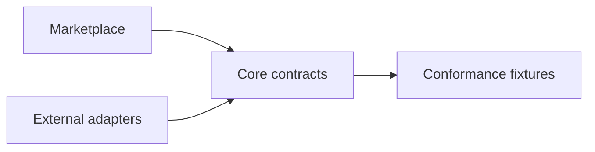

# AI Dev Team Core
**Open contracts for reliable AI software engineering**

[Marketplace](https://github.com/JavierQuinan/ai-dev-team-marketplace) · [Architecture](docs/ARCHITECTURE.md) · [Roadmap](ROADMAP.md) · [Security](SECURITY.md)

> Status: foundation and specification development. No stable runtime or package release is claimed.

Core defines portable, versioned contracts for agent roles, task graphs, handoffs, evidence, permissions and evaluation. It is not a hosted service, provider client or commercial orchestration engine.

## Architecture

## Planned modules
| Path | Responsibility |
|---|---|
| schemas/ | Canonical JSON Schema contracts |
| packages/contracts/ | Generated or validated TypeScript types |
| packages/policy/ | Portable policy definitions |
| packages/conformance/ | Positive and negative fixtures |
| docs/adr/ | Architecture decisions |
| tests/ | Contract and compatibility tests |

## Principles
Provider-neutral, deterministic validation, explicit versioning, deny-by-default capabilities, evidence over assertions. No credentials, private prompts, commercial routing, customer code or production telemetry.

## Getting involved
Read [the roadmap](ROADMAP.md) and [architecture](docs/ARCHITECTURE.md). Package installation instructions will be published only after a verified release.

## License
Apache-2.0. See [LICENSE](LICENSE) and [NOTICE](NOTICE). Third-party names do not imply endorsement.
